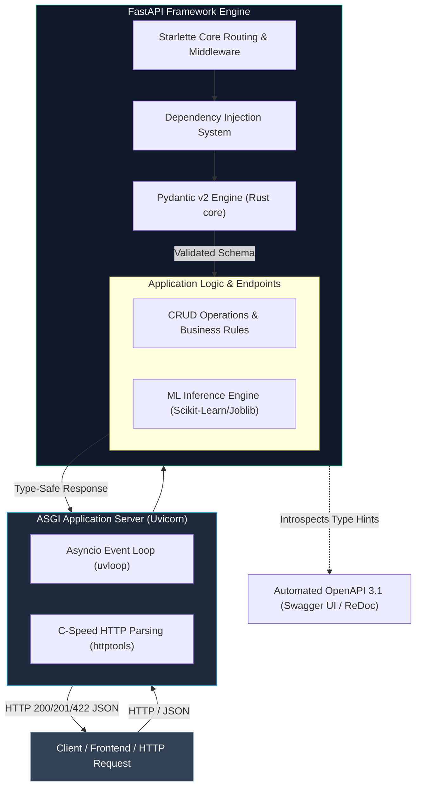
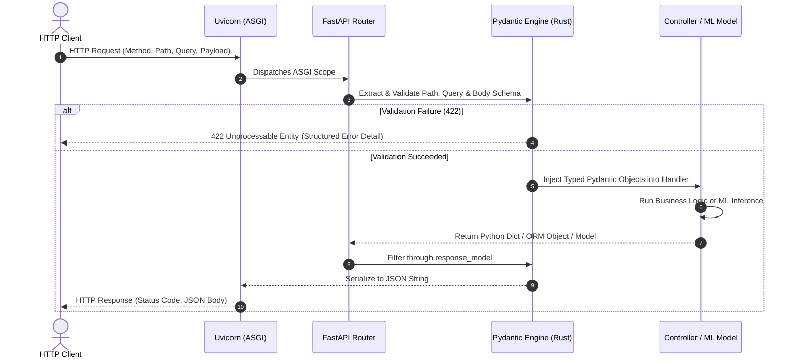

# ⚡ ApiVerse

> **A Production-Grade Roadmap to Modern API Engineering & Machine Learning Model Serving with FastAPI**

---

## 📌 Executive Overview

**ApiVerse** is a structured, engineering-first laboratory designed to master modern backend architecture, RESTful API design, asynchronous execution, and low-latency Machine Learning model inference using **FastAPI**, **Starlette**, and **Pydantic**.

Moving progressively from first principles (client-server network protocols and ASGI event loops) to deployment-ready ML microservices, this repository documents real-world design patterns, type-safe data pipelines, and production performance optimizations.

---

## 🏛️ System Architecture

FastAPI operates as a high-level asynchronous orchestration layer built on top of **Starlette** (for raw ASGI routing and web server capabilities) and **Pydantic** (for Rust-powered validation and JSON schema serialization).

---

## 🔄 End-to-End Request & Validation Lifecycle

Every request submitted to FastAPI flows through strict parsing, dependency resolution, schema validation, and serialisation:

---

## 🗺️ Learning Roadmap & Curriculum Structure

This repository tracks the **CampusX FastAPI & Machine Learning Masterclass** curriculum, systematically advancing from fundamental concepts to enterprise-grade model serving:

```mermaid
flowchart LR
    M1["01. API Core & Protocols"] --> M2["02. FastAPI Architecture"]
    M2 --> M3["03. HTTP Methods & REST"]
    M3 --> M4["04. Path & Query Params"]
    M4 --> M5["05. Pydantic v2 Mastery"]
    M5 --> M6["06. POST & Request Bodies"]
    M6 --> M7["07. Full CRUD Lifecycle"]
    M7 --> M8["08. ML Model Serving"]
    M8 --> M9["09. Production Hardening"]

    classDef step fill:#1e1e2e,stroke:#89b4fa,stroke-width:2px,color:#cdd6f4;
    class M1,M2,M3,M4,M5,M6,M7,M8,M9 step;
```

### Module Breakdown

| Module                            | Focus Area                  | Key Technologies & Concepts                                                    |
| :-------------------------------- | :-------------------------- | :----------------------------------------------------------------------------- |
| **01. API Fundamentals**    | Core Network Architecture   | Client-Server Model, HTTP/HTTPS, Statelessness, ASGI vs WSGI                   |
| **02. FastAPI Philosophy**  | Runtime & Server Setup      | Uvicorn, Starlette, Asynchronous Event Loop, Interactive OpenAPI Docs          |
| **03. HTTP Methods**        | RESTful Endpoint Design     | GET, Safe & Idempotent Methods, HTTP Status Codes, Route Decorators            |
| **04. Parameters & Types**  | Input Data Binding          | Path Parameters, Query Parameters, Type Conversion, Default Arguments          |
| **05. Pydantic Deep-Dive**  | Data Validation & Integrity | `BaseModel`, `Field`, Constraints, Rust Validation Core, Nested Models     |
| **06. POST & Request Body** | Payload Handling            | JSON Body Deserialization, Schema Enforcement,`response_model` Filtering     |
| **07. CRUD & Mutations**    | Complete State Operations   | PUT, PATCH, DELETE,`HTTPException`, Error Handling Patterns                  |
| **08. ML Model Serving**    | Model Inference Pipelines   | Serialized Artifacts (`joblib`/`pickle`), Feature Vectors, Prediction APIs |
| **09. API Optimization**    | Production Hardening        | Modular`APIRouter`, Custom Middleware, CORS, Dependency Injection, Profiling |

---

## ⚡ Tech Stack & Specifications

| Technology             | Role                             | Documentation                                  |
| :--------------------- | :------------------------------- | :--------------------------------------------- |
| **FastAPI**      | Async Web Framework              | [FastAPI Docs](https://fastapi.tiangolo.com/)   |
| **Pydantic v2**  | Data Parsing & Rust Validation   | [Pydantic Docs](https://docs.pydantic.dev/)     |
| **Starlette**    | ASGI Web Toolkit                 | [Starlette Docs](https://www.starlette.io/)     |
| **Uvicorn**      | ASGI Web Server                  | [Uvicorn Docs](https://www.uvicorn.org/)        |
| **OpenAPI 3.1**  | Standard API Specification       | [OpenAPI Initiative](https://www.openapis.org/) |
| **Scikit-Learn** | ML Artifact Pipeline Integration | [Scikit-Learn Docs](https://scikit-learn.org/)  |

---

